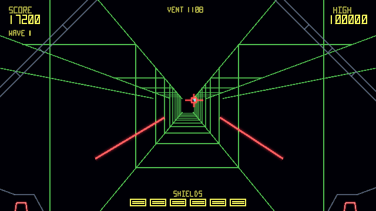
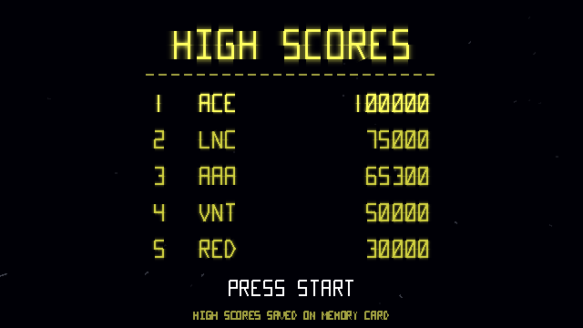
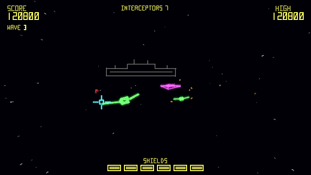
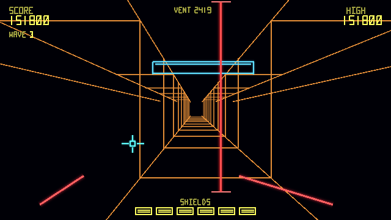
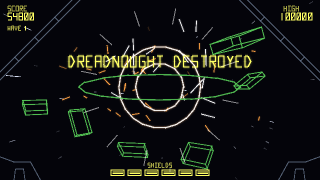
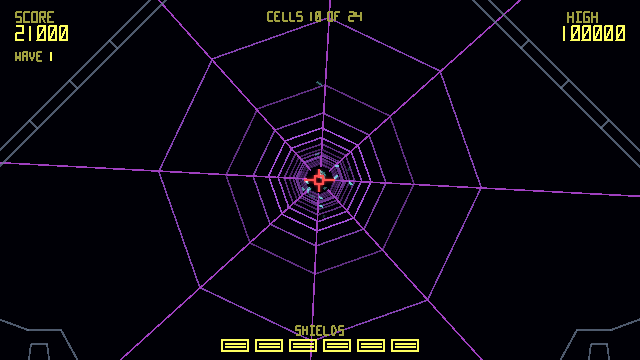

# Lancer for Vircon32

Version 1.0. A trench-run space shooter in the spirit of the 1983 vector arcade games, drawn entirely in glowing vector lines. Each wave you strike at an enemy dreadnought in three phases: dogfight its interceptors, skim its hull shooting gun towers, then dive down a trench to hit the reactor vent. Three classes of dreadnought, bombers, mines, shield generators and laser gates, a chiptune soundtrack, four modes to unlock, a Pilot Record of feats, and a secret or two.

Load **Lancer.v32** in the Vircon32 emulator.



## How to play

| Input | Action |
|---|---|
| D-pad | Move the crosshair. Over the hull and in the trench it also steers your ship |
| B or A | Fire both lasers at the crosshair (hold to keep firing) |
| Start | Start / pause |
| Y (title screen) | Options |

Your lasers hit whatever is under the crosshair; it turns red when you're on target.

**The three phases of each wave**

1. **Interceptors.** Fighters swoop in, strafe across your view and loop away, hurling fireballs. Shoot them down; holding the crosshair off-centre slowly turns your view after them. The dreadnought looms larger in the distance as you clear the wave. From wave 2, magenta **bombers** cross the view and fire spreads of three fireballs; they take three hits. From wave 3, red **mines** drift in and home on you: shoot them before they arrive.
2. **The hull.** You skim low over the dreadnought's hull. Gun towers rise ahead and fire at you: shoot them as they come. Steer left and right with the crosshair. From wave 2 the hull also carries domed **shield generators**: each one you destroy removes two turrets from the trench ahead.
3. **The trench.** You dive into a trench in the hull. The crosshair steers you around the trench's cross-section. Turrets on the walls fire at you, and from wave 2 catwalks span the trench: fly above or below them. From wave 3, **laser gates** cross the trench, upright or level, switching on and off: a beep warns you as one approaches, and you pass through while it's off or fly around the beam. At the far end is the **reactor vent** in the floor: when "FIRE AT THE VENT" flashes, put the crosshair on it and fire. Miss, and you go round for another run.

Hit the vent and the dreadnought explodes. You get a shield back and the next wave begins, faster and fiercer: quicker fighters and fireballs, more of them, more towers, a longer trench with more turrets and catwalks.

**Dreadnought classes.** The dreadnoughts come in three classes, in turn: the green **Lance**, the blue **Carrier**, which launches an extra bomber, and the orange **Bastion**, with an extra shield generator and two more laser gates. Each has its own silhouette in the distance, and its hull and trench take its colour.

**Fireballs** are the enemy's main weapon, and you can shoot them down. Any that reach you cost a shield. You have six shields (eight on Easy, four on Hard); lose the last and the game is over. Every hit cracks the canopy, and the crack stays until the shield is restored at the end of a wave.

**Scoring**

| Target | Points |
|---|---|
| Fireball | 100 |
| Trench turret | 300 |
| Gun tower | 500 (5,000 bonus for destroying every tower in a pass) |
| Mine | 300 |
| Interceptor | 1,000 |
| Shield generator | 2,000 |
| Bomber | 2,500 |
| Dreadnought | 25,000, plus 2,000 for each shield you still have |

Last Pilot mode doubles every score.

## Menus and saving

- **Pause:** Start pauses. Choose Resume, Options or Quit to title (press B twice to quit, so you can't do it by accident).
- **Options** (Y on the title screen, or from the pause menu): music volume, effects volume, difficulty, screen shake, screen flashes, display colours (once you've unlocked some), and resetting the high scores. Easy gives you 8 shields, slower fireballs and less enemy fire; Hard gives you 4, faster fireballs and more fire. A difficulty change made mid-game takes effect in the next game.
- **High scores:** a top-5 table. Make the table and you enter three initials (Up/Down change a letter, Left/Right or B move, Start finishes). Scores set on Easy or Hard are tagged E or H.
- **Attract mode:** left at the title, the game shows the high scores and the Pilot Record, then plays a recorded demo: a whole first wave, from the interceptors to the dreadnought exploding, and the start of the second. When you beat the demo game's score (72,800), the opening of your game replaces it. Press Start to leave the demo.
- **Memory card:** with a card inserted, the high scores, your options, your Pilot Record, the best score in each mode and a replay of your best game are saved to it. The title screen says whether scores will be saved. Lancer uses its own signature on the card, so it won't touch a card that belongs to another game.









## Pilot Record, modes and displays

Feats you achieve are kept in your **Pilot Record**, which the title screen shows between the high scores and the demo. Each one unlocks something:

| Feat | How | Unlocks |
|---|---|---|
| Dreadnought Down | Destroy a dreadnought | Trench Run mode |
| Flawless Wave | Finish a wave without losing a shield | Time Attack mode |
| Clean Sweep | Destroy every turret in one trench run | Amber display |
| Bomber Ace | Shoot down 5 bombers in one game | Green display |
| Fleet Breaker | Destroy 3 dreadnoughts in one Standard game | Last Pilot mode |
| Ace Pilot | Score 200,000 in one Standard game | White display |
| *two more* | *secrets: the record only says "A SECRET" until you find them* | |

Once a mode is unlocked, Start on the title screen opens **Select Mode**:

- **Standard:** the full game.
- **Trench Run:** trench after trench, with 3 shields (4 on Easy, 2 on Hard) and one back for each vent.
- **Time Attack:** three minutes on the clock instead of shields. A hit costs 10 seconds, a vent gives 30.
- **Last Pilot:** one shield, no repairs, and every point counts double.

Each mode keeps its own best score, with initials, shown on the mode screen. Modes don't record attract demos and don't enter the Standard high score table.

The **display** option recolours everything: Colour (as designed), Amber, Green or White, like the monochrome vector monitors of old, and one more for whoever finds both secrets.

<details>
<summary>Spoilers: the two secrets</summary>

- **Trust Your Instincts:** in the trench, don't fire at all until the vent, then hit it with your one and only shot. Instead of the dreadnought blowing up, you find a way inside: **the core**, a tunnel to the reactor lined with 24 energy cells (500 each). You can't lose shields in there. At the end the reactor goes up and takes the dreadnought with it. This works every time you manage it, not just the first.
- **Core Breach:** shoot every one of the 24 cells in the core, for a 20,000 bonus and the **Spectrum** display, whose colours shift and drift.

</details>



## Music

Seven chiptune tracks in D minor, played on the console by a small note sequencer (`chipmusic.h`) from eight tiny instrument samples, so the whole soundtrack adds only about 13 KB of note data:

- **Title theme:** a heroic fanfare and march, 34 seconds, for the title pages, the attract demo and initials entry.
- **Interceptors:** a driving dogfight theme with a soaring lead.
- **The hull:** syncopated, menacing stabs over a pounding bass.
- **The trench:** an urgent 150 BPM run that lurches between D minor and E flat.
- **Victory fanfare:** silence while the dreadnought burns, then a turn to D major at the blast.
- **Game over:** a short sting falling to D minor.
- **The core:** a glittering arpeggio, for somewhere you weren't supposed to find.

The music ducks while the game is paused, and the music volume (0 to 10) is saved on the memory card with the other options.

## Version history

See `CHANGELOG.md`: 0.1 the playable core, 0.2 menus and saving, 0.3 more variety, 0.4 game feel, 0.5 music, 0.6 secrets and unlockables, 1.0 the release pass.

## What's here

- `Lancer.v32`: the game, ready to play.
- `Lancer.c`: its source.
- `CHANGELOG.md`, `LICENSE` (MIT).
- `vector.h`: the vector library (Ironplain's copy, which draws a zero-length line as a dot instead of halting the console on `atan2( 0, 0 )`).
- `make_sounds.py`: synthesizes the 13 sound effects and the 8 music instruments into `sounds/`, and regenerates `music_data.h`.
- `make_music.py`: the songs, written as note strings; `music_data.h` is its output.
- `chipmusic.h`: the note sequencer that plays them (shared with Ironplain).
- `Lancer_title_theme.mp3`, `Lancer_wave_1.mp3`, `Lancer_game_over.mp3`: recordings of the music from the console, for listening outside the emulator.
- `Lancer.xml`, `vector_lines.png`: ROM definition and line texture.
- `demo_builtin.h`: the built-in attract demo (a seed and recorded inputs).
- `tools/gen_demo.py`: turns a memory card holding a recorded game into `demo_builtin.h`.
- `tools/headless.cpp`: the headless emulator harness used for testing.
- `screenshots/`: the title, interceptors, the hull, the trench, the vent in range, the dreadnought destroyed, the high score table, the options screen, the pause menu, bombers, a shield generator, a laser gate, a Bastion's hull, the cracked canopy, the dive into the trench, the dreadnought breaking up, the final blast, the Pilot Record, the mode screen and the core; `screenshots_sheet.png` puts a selection on one page.

## How it draws

The camera never moves: everything is placed relative to it, with x to the right, y down and z ahead. Over the hull and in the trench the world streams toward you and shifts as you steer; in space, holding the crosshair off-centre rotates everything slightly around you. Models whose corners are all on screen are projected once per corner and drawn as plain 2D lines; the rest go through `vec_line_3d` with clipping. Explosion debris stops drawing for the rest of a frame once most of the frame's CPU time is used, so the busiest moments never drop frames. The dives between phases move the camera's centre of projection rather than the finished picture, so lines are still clipped to the screen. The world is flushed before the HUD is drawn, so a busy explosion can't crowd the score and text out of the line queue. Everything in the cockpit, the cracks and the wreckage uses the effects random numbers, never the gameplay ones, so replays are unaffected.

## Building

With the Vircon32 dev tools on your PATH, and Python 3 with NumPy:

```
python3 make_sounds.py
png2vircon vector_lines.png -o vector_lines.vtex
mkdir -p obj
compile Lancer.c -o obj/Lancer.asm
assemble obj/Lancer.asm -o obj/Lancer.vbin
packrom Lancer.xml -o Lancer.v32
```

## How the demos replay

Each game records your inputs (6 bits a frame, packed five frames to a word) and the seed of the game's own random number generator, which is kept separate from the one used for visual effects. Replaying the same inputs from the same seed reproduces the game exactly. A recording keeps the first 60 seconds of a game. Saved demos also carry the version of the rules they were recorded under, so a demo from an older version that would no longer replay the same is set aside.
